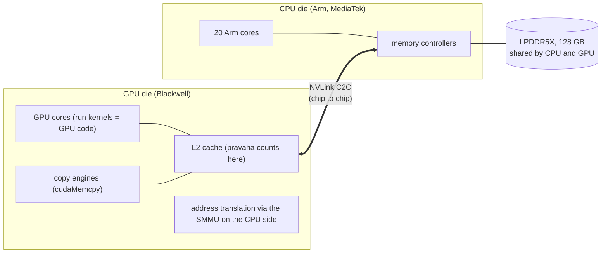
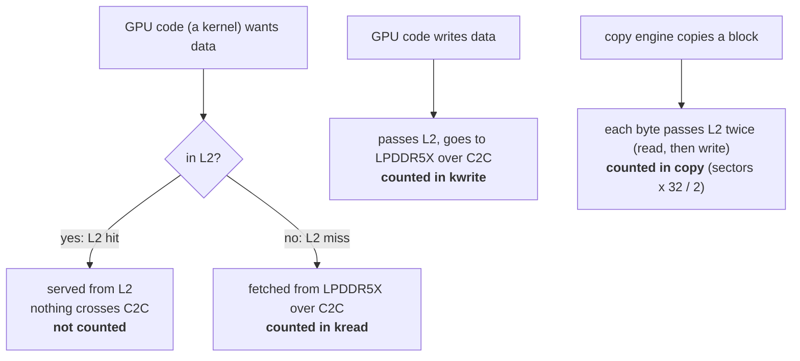
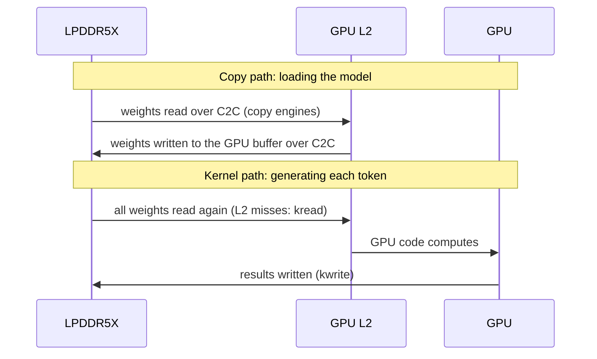

# The NVIDIA GB10, and what pravaha measures in it

The GB10 is new, and it differs from a normal PC with a graphics card in one way that matters for everything else: **the GPU has no memory of its own.**

## 1. Two chips, one memory

* The **CPU die** holds the Arm cores and the memory controllers. The 128 GB of LPDDR5X is attached here.
* The **GPU die** holds the GPU cores, the copy engines and the L2 cache, but **no memory**.
* **NVLink C2C** joins the two dies. Every byte the GPU reads from memory or writes to memory crosses it.
* Even "GPU memory" (`cudaMalloc`) is a part of the same LPDDR5X behind the CPU die.

On a normal PC the graphics card has its own memory, and only explicit copies cross the link to the CPU. On the GB10, **all GPU memory traffic crosses the link.**

## 2. The missing counter

NVIDIA's tools (nvidia-smi, Nsight Systems, DCGM) report no traffic counter for NVLink C2C on the GB10. So nobody could see how many bytes a program moves over the link, or when. pravaha fills that gap.

## 3. Where pravaha counts: the L2 cache

Every request from the GPU to memory passes the GPU's **L2 cache** first. The L2 keeps its own counts, in units of **sectors** of 32 bytes, and separately for who asked:

| pravaha column | what it counts | the L2 counter |
|---|---|---|
| **copy** | bytes copied by the copy engines | `lts__t_sectors_srcunit_ce` |
| **kread** | bytes GPU code read that were **not** in L2 (misses) | `lts__t_sectors_srcunit_tex_op_read_lookup_miss_realtime` |
| **kwrite** | bytes GPU code wrote | `lts__t_sectors_srcunit_tex_op_write_realtime` |
| **C2C** | all L2 misses and all writes, from every source: everything that crossed the link | `lts__t_sectors_op_read_lookup_miss_realtime` + `lts__t_sectors_op_write_realtime` |

An analogy that helps: the GPU is a kitchen without a fridge, the memory is a store across the road (C2C), and L2 is a small pantry at the kitchen door. pravaha counts every trip across the road: for the cooks (kread, kwrite), for the delivery vans (copy), and in total (C2C).

## 4. The two paths, in a real LLM

Measured with vLLM serving Qwen3 4B (weights 7.49 GiB): loading showed 7.80 GiB of copies; each generated token showed 7.52 GiB of kread, because a 7.5 GiB model cannot fit in an L2 cache of a few tens of MiB, so every token misses on every weight.

## 5. Why a copy shows twice its size on C2C

Both buffers of a copy live in the same LPDDR5X. Copying 2 GiB into the GPU means reading 2 GiB from memory and writing 2 GiB back to memory: about **4 GiB over C2C** for **2 GiB copied**. A `cudaMemset` of 4 GiB only writes: about 4 GiB over C2C. A GPU to GPU copy of 4 GiB reads 4 and writes 4: about 8 GiB.

## 6. The SMMU (address translation)

Programs use virtual addresses. The GB10's SMMU (on the CPU side) translates them into memory addresses, one page (usually 4 KiB) at a time, and caches recent translations. Its counters (`smmuv3_pmcg_*`, 7 of them for the GPU) count **translations, not bytes**. pravaha reports them separately (`pravaha smmu`), for studying page sizes and translation caching.
